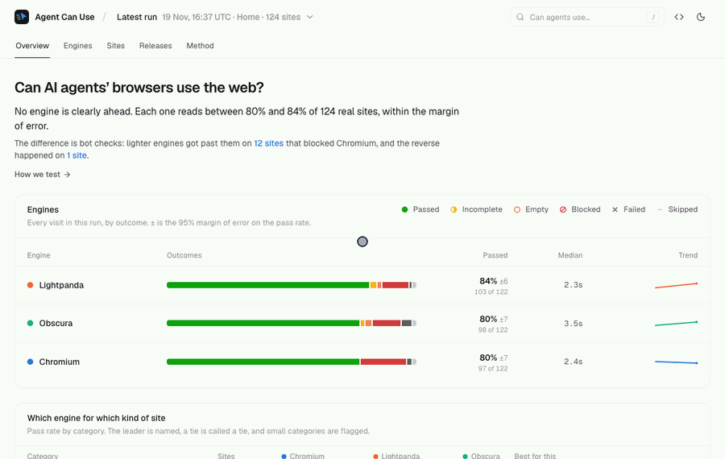

# agentcanuse

**caniuse, but for the browsers ai agents use.** see it at [agentcanuse.com](https://agentcanuse.com).



agents don't browse with chrome much anymore. they use lighter engines built for them: [Lightpanda](https://github.com/lightpanda-io/browser), [Obscura](https://github.com/h4ckf0r0day/obscura), and Cloudflare's [Kitesurf](https://github.com/cloudflare/kitesurf), open source since 13 november. they're faster and cheaper than chromium, and they break on some real sites. every comparison so far is a one-off, mostly run by the people who make the engine.

agentcanuse runs every engine against the same list of real sites, scores each visit the same way, and keeps the history. so you can see which engine renders the page, finds the content, and gets let in, and what changed when an engine shipped a new release.

## what it checks

each site in [`sites.json`](sites.json) comes with a couple of phrases a person would look for on it, like "Christmas Day" on the gov.uk bank holidays page. every engine visits the page once, waits for it to load, and reads the text. the visit gets one outcome:

| outcome | means |
| --- | --- |
| passed | every expected phrase was on the page |
| incomplete | the page loaded, but some expected content was missing |
| empty | almost no text came back |
| blocked | the site answered 401, 403, 429 or 503, or showed a bot check |
| failed | the engine errored or timed out |
| skipped | not visited, because `robots.txt` asks us not to |

the leaderboard ranks engines by pass rate over the sites they attempted. the sites tab shows each page side by side, screenshots where the engine can paint one. the releases tab compares an engine's latest run with its last run on a different version, and lists the sites that started or stopped passing.

## what it can't tell you yet

- **it only reads the page.** nothing clicks, types or fills in a form, so it measures what an agent can see, not what it can do.
- **"blocked" depends on where it runs.** a run from a data centre gets blocked more than an agent on a home connection would.
- **kitesurf isn't in the results yet.** it runs on Cloudflare Workers, its README warns against opening untrusted sites with a local copy, and hosting it needs a paid Workers plan. the runner drives it as soon as `KITESURF_ENDPOINT` points at a deployed instance.
- **agent-browser isn't here because it isn't an engine.** it drives chromium or lightpanda, which are both already measured.
- **thirty sites is a sample, not a census.**

## what's in it so far

two runs from 19 november, from a home connection in the uk. the first ran the previous releases (Lightpanda 1.0.1, Obscura v0.2.4) so the releases tab had something to compare. the second ran the current ones. chromium and lightpanda both passed 22 of the 28 sites they could visit, obscura 20. most of the rest were sites blocking every engine, chromium included. Stack Overflow and the Internet Archive were skipped because their `robots.txt` couldn't be read.

a survey also runs every night on GitHub Actions, and another starts within six hours of a new Lightpanda or Obscura release, so the releases tab shows what each release changed. those runs come from a data centre, which sites tend to block more than a home connection, so the site labels where each run came from, and the releases tab compares runs from the same kind of network when it can.

## check your own site

you don't need to clone anything. with Node 22.12 or newer:

```sh
npx github:j4ckwinter/agentcanuse check https://your-site.com
```

it downloads each engine the first time (into `~/.cache/agentcanuse`), visits the page once with each, and prints what happened:

```
https://www.gov.uk/bank-holidays

engine      version        outcome  status  time  detail
chromium    158.0.8127.36  passed   200     1.9s  5,994 characters read
lightpanda  1.0.4          passed   200     1.7s  16,132 characters read
obscura     v0.2.7         passed   200     2.4s  16,137 characters read

Works everywhere. Every engine could read gov.uk.
```

add `--expect "some text"` (as many as you like) to check the page shows what it should, `--engine lightpanda` to try one engine, or `--json` for the raw results. every site page on agentcanuse.com has the exact command for that site.

## run it

you need Node 22.12 or newer.

```sh
git clone https://github.com/j4ckwinter/agentcanuse.git
cd agentcanuse
npm ci
npm run dev
```

that opens the site on the runs already in `public/data`. to run a survey of your own:

```sh
npm run bench                                          # every engine, every site
npm run bench -- --engines lightpanda --sites gov-uk   # just one
npm run bench -- --pin lightpanda=1.0.1                # an older release
npm run bench -- --origin data-centre                  # label a run from a server
```

engines download into `.cache/engines` the first time. a run writes `public/data/runs/<id>.json` and thumbnails, and adds itself to `public/data/index.json`. only the latest run keeps its thumbnails, because that's the only one the site shows.

## being polite

every engine visits each site once per run, one page at a time. before any of that, the runner asks `robots.txt` whether `agentcanuse` may visit, and skips the site if not, or if it can't tell. the engines run their standard builds, never a stealth mode: getting blocked is one of the things it measures.
